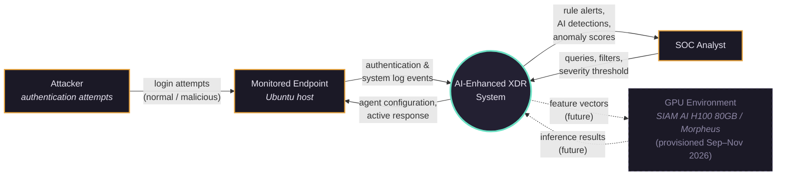
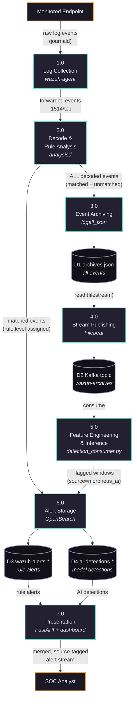
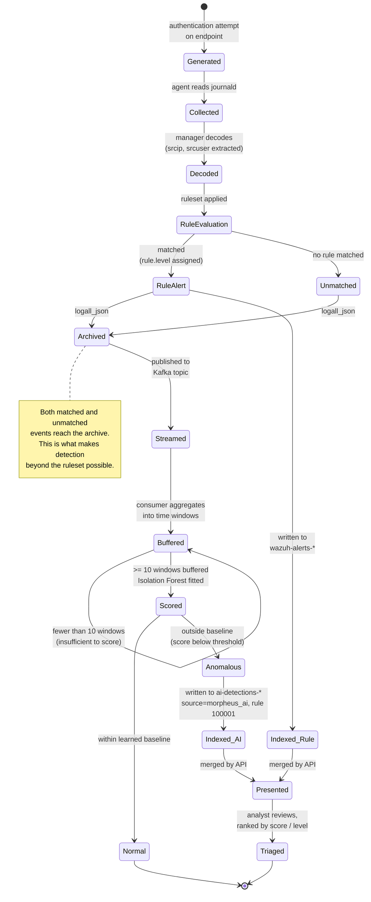

# SAD Diagrams — บทที่ 3
### AI-Enhanced XDR: Wazuh + Anomaly Detection Pipeline

These diagrams describe the system **as built**, not as originally proposed. Differences from the proposal are noted where they exist.

**Rendering:** paste any block into <https://mermaid.live>, export PNG/SVG, insert into the report. Or use a Mermaid-capable editor. The source is kept here so diagrams can be regenerated when the system changes.

---

## 1. Context Diagram (DFD Level 0)

The system as a single process, with the external entities it exchanges data with.

**Note for the report:** the GPU environment is drawn with dashed edges to mark the boundary between the locally-built core and the Morpheus deployment on external (SIAM AI) hardware. As of Sep 2026 that hardware is **provisioned** — an H100 80GB, passthrough, available 2 Sep – 30 Nov 2026 — so this is an active deployment target, not a hypothetical one. The earlier framing (development GPU is AMD / no CUDA) no longer applies; that constraint was lifted when SIAM AI provided the H100. Once Morpheus is running on it, redraw these edges solid. *(The host also carries a BlueField-3 DPU. It is not shown because the network lane it was intended for is out of scope.)*

---

## 2. Data Flow Diagram — Level 1

The seven processes actually implemented, with the four data stores they use.

### The critical path in this diagram

Process **2.0** has two outputs, and the distinction is the basis of the entire project:

- **to 6.0 (alerts)** — only events that matched a rule. This is what a conventional SIEM deployment stores.
- **to 3.0 (archive)** — *every* decoded event, matched or not. This path exists only because `logall_json` is enabled.

The AI branch (3.0 → 4.0 → 5.0) consumes the **archive**, not the alerts. If it consumed alerts, it could only ever see events the ruleset had already caught, and could not detect what the ruleset misses.

### Implementation note for §3.3

Process **4.0** is a **second Filebeat instance** with a Kafka output, in its own container. The manager's built-in Filebeat cannot do it: Filebeat supports a single output at a time and that one already ships rule alerts to the indexer, so adding Kafka there would mean dropping the indexer output (and with it the Wazuh dashboard). The second instance reads the manager's archive from its log volume, read-only.

Until 2026-10-18 a Python tailer (`archive_producer.py`, `tail -F` via `docker exec`) stood in for it. It was replaced because it only read new lines from the moment it started: events written while it was down never reached Kafka. Filebeat records its read position and resumes from it.

---

## 3. Data Dictionary

Fields actually used by the system, as opposed to the full Wazuh schema.

### 3.1 Archived event (input to the AI pipeline) — `archives.json`

| Field | Type | Description | Example |
|---|---|---|---|
| `timestamp` | ISO 8601 datetime | Event time, UTC | `2026-07-19T01:47:12.084+0000` |
| `agent.id` | string(3) | Reporting agent identifier | `001` |
| `agent.name` | string | Agent hostname | `ubuntu-vm` |
| `manager.name` | string | Receiving manager | `wazuh.manager` |
| `rule.id` | string | Matched rule identifier; absent if no rule matched | `5710` |
| `rule.level` | integer 0–15 | Severity assigned by the ruleset | `5` |
| `rule.description` | string | Human-readable rule description | `sshd: Attempt to login using a non-existent user` |
| `decoder.name` | string | Decoder that parsed the event | `sshd` |
| `data.srcip` | string (IPv4) | Source address of the attempt | `127.0.0.1` |
| `data.srcuser` | string | Username attempted; **absent for PAM events** | `admin` |
| `full_log` | string | Original unparsed log line | `Failed password for invalid user admin from 127.0.0.1 port 54990 ssh2` |
| `location` | string | Collection source | `journald` |

**Note:** `data.srcuser` is populated by the `sshd` decoder but not by the `pam` decoder. The feature-engineering stage recovers the username from `full_log` by pattern match when the field is absent. See failure log Entry 9 — the omission silently produced a distinct-user count of zero, which removed the strongest slow-attack signal.

### 3.2 Derived feature vector (input to the model)

One record per time window.

| Field | Type | Derivation | Purpose |
|---|---|---|---|
| `window_start` | datetime | Event time truncated to window size | Window identity |
| `event_count` | integer | Count of auth events in the window | Volume signal — detects bursts |
| `distinct_users` | integer | Unique `srcuser` values in the window | Username-cycling signal — **rate-independent**, so it survives slow attacks |
| `max_level` | integer 0–15 | Highest `rule.level` in the window | Severity signal |
| `hour` | integer 0–23 | Hour of day, UTC | Temporal signal — off-hours activity |
| `events_per_user` | float | `event_count / distinct_users` | Repetition per identity |
| `user_diversity` | float | `distinct_users / event_count` | Breadth of identities attempted |

**Excluded:** `srcip` is constant (`127.0.0.1`) across the lab dataset and therefore carries no information. Stated as a limitation in บทที่ 5.

### 3.3 AI detection record (output) — `ai-detections-*`

| Field | Type | Description | Example |
|---|---|---|---|
| `timestamp` | ISO 8601 datetime | Start of the flagged window | `2026-07-19T01:47:00+00:00` |
| `source` | string | Origin tag distinguishing AI from rule alerts | `morpheus_ai` |
| `rule.id` | string | Custom identifier, 100000+ range per §3.5 | `100001` |
| `rule.level` | integer | Assigned severity | `10` |
| `rule.description` | string | Detection description | `AI: anomalous authentication behaviour detected` |
| `ai.model` | string | Model that produced the detection | `IsolationForest` |
| `ai.pipeline` | string | Execution path | `kafka-streaming` |
| `ai.anomaly_score` | float (negative) | Isolation Forest score; **lower is more anomalous** | `-0.7240` |
| `ai.window` | string | Aggregation window size | `60s` |
| `ai.event_count` | integer | Events in the flagged window | `5` |
| `ai.distinct_users` | integer | Distinct usernames in the window | `2` |
| `agent.name` | string | Source agent | `ubuntu-vm` |

**Design note:** `source` and the 100000+ rule ID range together implement the alert-deduplication scheme in §3.5, allowing AI detections and rule alerts to be stored together yet distinguished at query and presentation time.

---

## 4. State Diagram — Event and Alert Lifecycle

Traced from observed behaviour, not designed in the abstract.

### States worth explaining in the report

**`Unmatched`** — events that match no rule. Under a default Wazuh deployment these are discarded. Enabling `logall_json` routes them to the archive, which is the precondition for detecting activity the ruleset does not describe.

**`Buffered` self-transition** — the consumer refuses to score until at least ten windows have accumulated. Isolation Forest fitted on fewer samples produces output that appears valid but is not statistically meaningful (failure log Entry 9). The guard is deliberate.

**Two paths to `Presented`** — rule alerts and AI detections converge at presentation but are stored separately and remain distinguishable by their `source` tag. This is what allows the dashboard to display the difference between them, which is the project's central comparison.

---

## Divergences from the original proposal

State these in §3.3 so the built system and the documented design agree.

| Proposal (Figure 3.1) | As built | Reason |
|---|---|---|
| Morpheus performs inference | Isolation Forest on CPU (core build); Morpheus deployment on provided H100 (Sep–Nov 2026) | Original local GPU (AMD RX 5700 XT) could not run CUDA, so the method was first proven on CPU. SIAM AI then provided an H100 80GB, so Morpheus moves from documented target to actual deployment. The CPU implementation stands as the equivalence baseline. |
| Triton in the data path | Not implemented | Triton is a model-serving service invoked by request/response, not a stage data flows through. Correction already applied to §3.3. |
| AI alerts returned via Wazuh REST API | Written directly to OpenSearch (`ai-detections-*`) | The REST API on port 55000 is a management interface, not an alert-ingestion path. |
| Pre-trained model, no training | Baseline fitted on local data | DFP requires a baseline fitted per environment; no pre-trained model can encode this system's normal behaviour. See §2.1.3. |
